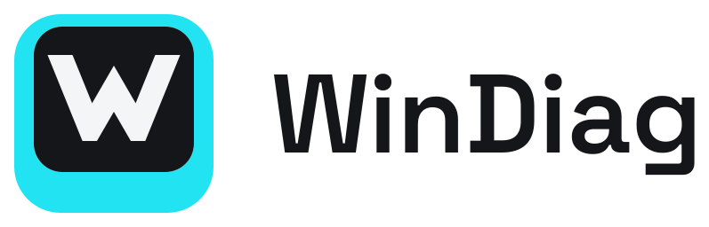

<p>
  <picture>
    <source media="(prefers-color-scheme: dark)" srcset="brand/svg/windiag-horizontal-on-dark.svg">
    
  </picture>
</p>

# WinDiag

Look after your own Windows PC, safely and in plain words. WinDiag checks how your PC is doing, explains what it finds and takes you to the fix: no jargon, no risky tweaks, and every change can be undone.

- **Status:** in development. The one-click checkup and the hardware tests work; the other pages are on the way.
- **Website:** [jotnardev.github.io/WinDiag](https://jotnardev.github.io/WinDiag/).
- **Author:** JOTNAR.
- **Stack:** Electron 44 · electron-vite 5 · React 19 · Tailwind CSS 4 · Fluent UI icons · systeminformation.

> If you are an AI or a developer taking over the project, also read [HANDOFF.md](HANDOFF.md).

---

## Features

| Page | What it does | Status |
|---|---|---|
| **Home** | A one-click checkup: protection, Windows updates, drive health, free space, battery, startup apps, activation and last restart, each with a plain verdict and a button to the right Windows page. Read-only; needs no admin rights. | Ready |
| **Hardware** | Tests for the keyboard and mouse, screen, touch, sound and camera, battery, drives and USB ports, and a **gamepad tester**: it identifies the controller and explains why it misbehaves (stick drift and range, triggers, buttons that stick or don't respond, vibration, disconnects). | Ready |
| **Speed up** | Startup apps, cleaning up temporary files, power mode. | In beta |
| **Privacy** | Telemetry, activity history, suggestions and ads in Windows, each switch explained. | In beta |
| **Personalize** | Dark mode, File Explorer (extensions, hidden files, classic right-click menu), taskbar, pointer precision, Sticky Keys and Num Lock; each can be set back to Windows' default. | In beta |
| **Apps** | Trusted apps for work, gaming, design and development, installed with winget; update them all in one click. | In beta |
| **Updates** | Windows Update and its drivers installed in one go, with a restore point before drivers; your BIOS version and the maker's page for drivers and BIOS. | In beta |
| **Security** | Defender (definitions, scans, unwanted apps, tamper protection), firewall, updates, activation, drive encryption, Secure Boot and TPM, memory integrity and UAC, each explained, with the safe fixes one click away. | In beta |
| **Repair** | Repair system files, reset the network or Windows Update, restore points. | Planned |

## Requirements

Windows 10 or 11, 64-bit. WinDiag opens without asking for administrator rights; the actions that need them ask when they run.

---

## Development

```bash
npm install
npm run dev          # development mode with hot reload
npm run build        # builds main, preload and renderer into out/
npm run build:win    # installer and portable zip in dist-home/
```

- **Developing on another OS:** Windows features show "Couldn't check" or empty data. The app only works fully on Windows, because almost everything uses PowerShell and WMI.
- **Releases:** pushing a `vX.Y.Z` tag that matches `package.json` builds the installer and the portable zip on GitHub Actions and publishes a release with the notes from `CHANGELOG.md`.

### WinDiag Bench

This code base also builds **WinDiag Bench**, the edition for refurbishers and technicians (drivers and BIOS, users, delivery checks). Bench is a separate commercial product and its code isn't in this repository: its pages live in `bench/` folders that only the private repository has, and the build picks Home when they are missing (see [HANDOFF.md](HANDOFF.md)).

The code of earlier versions (up to 2.6.1, when the app was called WinDiag Fluent) stays in this repository’s history under the MIT licence.

---

## Brand

The logo is a keycap with a W: Cyan `#22E3F2` key, Carbon `#141619` top and a Paper `#F4F5F6` W, with "WinDiag" set in Space Grotesk. [`brand/`](brand/README.md) holds the SVG masters (symbol, a small cut for 32 px and below, horizontal and stacked lockups, one-colour versions), the PNG and `.ico` exports, the web icon set and the usage guidelines (colours, clear space, minimum sizes, misuse).

The app icons in `build/` and `resources/` and the website's icons are generated from the same geometry with `python3 brand/source/kit.py`.

---

---

## License

[MIT](LICENSE). Some of WinDiag's tweaks are reimplemented from [WinUtil](https://github.com/ChrisTitusTech/winutil) by Chris Titus Tech (MIT, © 2022 CT Tech Group LLC).
