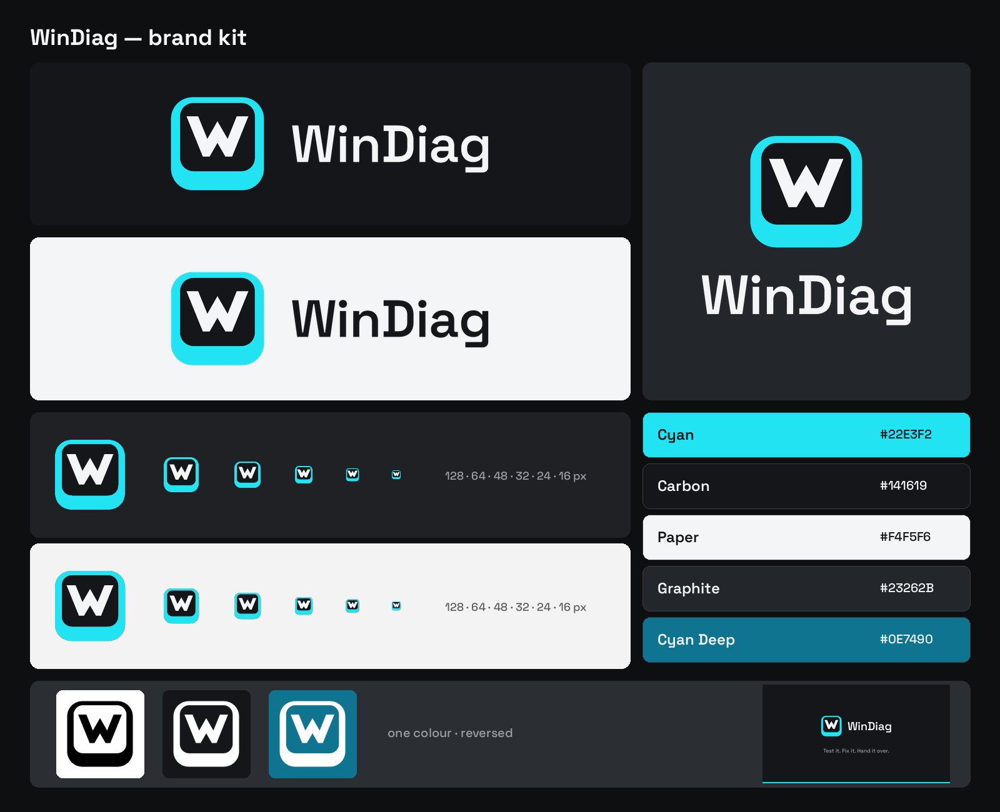

# WinDiag brand kit



**The idea:** a keycap with a W. It is the keyboard test that greets visitors on the website ("press any key"), turned into the mark of a tool that tests every part of a PC before it is handed over. The thicker bottom lip is what turns a rounded square into a *key*, without drawing a keyboard.

The mark avoids the category's clichés (gears, wrenches, magnifying glasses, stethoscopes, Windows logos) and replaces the pulse-line icon used up to 2.6.0.

---

## 1. Logo files

| Piece | Master | Use |
|---|---|---|
| Symbol | `svg/windiag-symbol.svg` | App icon, avatar, large favicon, mockups |
| Symbol, small cut | `svg/windiag-symbol-small.svg` | **32 px and below only** (taskbar, favicon, the 16–32 px sizes of the `.ico`). Thicker walls and a bigger W |
| Horizontal lockup | `svg/windiag-horizontal-on-dark.svg` / `-on-light.svg` | Website header, README, About screen, splash |
| Stacked lockup | `svg/windiag-stacked-on-dark.svg` / `-on-light.svg` | Square spaces, covers, stickers |
| Wordmark | `svg/windiag-wordmark-*.svg` | When the symbol is already nearby (a title bar next to the icon) |

Every piece also comes in one colour: `-black` and `-white`, plus `-cyan` and `-carbon` for the symbol. In the one-colour versions the key's top is a real hole (`evenodd`), so the background shows through.

`png/` has the symbol from 16 to 1024 px, the lockups at 1200/800 px, black and white symbols at 512 px and `og-image.png` (1200 × 630). `icons/windiag.ico` is the Windows icon (16, 24, 32, 48, 64, 128 and 256 px; the small cut for 16–32), and `icons/web/` the favicon and PWA set. `presentation/presentation.html` shows the mark on mockups (README, app icon, website, terminal, sticker, social).

## 2. Colour

| Name | HEX | RGB | CMYK (approx.) | Pantone (approx.) | Role |
|---|---|---|---|---|---|
| **Cyan** | `#22E3F2` | 34 227 242 | 60 0 10 0 | 319 C | Brand colour: the key's body, buttons |
| **Carbon** | `#141619` | 20 22 25 | 75 65 60 80 | Black 6 C | The key's top, dark grounds, text on light |
| **Paper** | `#F4F5F6` | 244 245 246 | 3 2 2 0 | 663 C | The W, text on dark, light grounds |
| Graphite | `#23262B` | 35 38 43 | 75 65 55 70 | 433 C | Secondary surfaces (cards, panels) |
| Cyan Deep | `#0E7490` | 14 116 144 | 90 35 25 15 | 7699 C | Cyan for **text and links on light grounds** |

**Contrast (WCAG):**

| Pair | Ratio | Use |
|---|---|---|
| Paper on Carbon | 16.6:1 | AAA |
| Cyan on Carbon | 11.5:1 | AAA, text included |
| Carbon on Cyan | 11.5:1 | AAA: button labels |
| Cyan on white | 1.6:1 | Large shapes such as the symbol only. **Not for text**: use Cyan Deep (4.9:1 on Paper) |

Cyan was chosen to stay clear of the blues, oranges and greens common among Windows, PC makers and rugged-laptop sellers. On a light taskbar the key's body is pale, so the Carbon top and the white W carry the icon there; keep it that way and do not add an outline.

**Status colours** (app and website). Each is always shown with an icon and a word, never by colour alone:

| Status | On dark (text / fill) | On light (text / fill) | Icon |
|---|---|---|---|
| Passed | `#9BE15D` / `#22331A` | `#3B6E12` / `#E6F6D6` | check |
| Check | `#FFC83D` / `#3A3116` | `#8A5A00` / `#FFF1C7` | warning |
| Failed | `#FF5C6C` / `#3D1E23` | `#B4233A` / `#FFE3E6` | cross |
| Running | `#22E3F2` / `#10343A` | `#0E7490` / `#D4F6FA` | progress |
| Not tested | `#A3A9B1` / `#2A2E34` | `#555B63` / `#E3E6EA` | dash |

Passed is a lime, not an emerald, to stay apart from the Cyan. On a Cyan surface, a status chip is Carbon with the on-dark colour.

The CMYK and Pantone values are screen approximations. Check them against a printed Pantone guide before printing.

## 3. Typography

- **Wordmark:** Space Grotesk, weight 600, converted to outlines, so the font does not need to be installed to use the logo. SIL Open Font License 1.1 (`source/fonts/OFL.txt`), which allows logo use.
- **App and website text:** Segoe UI Variable (Fluent), as before. Space Grotesk 500–700 for website headings.

## 4. Clear space and minimum sizes

- **Clear space:** a quarter of the symbol's height on every side (64 px for a 256 px symbol). For the lockups, measure it on the symbol.
- **Symbol to wordmark gap:** fixed in the masters (48/256 of the symbol's height). Do not change it.

| Piece | Minimum on screen | Minimum in print |
|---|---|---|
| Symbol | 16 px (the small cut from 32 px down) | 6 mm |
| Horizontal | 24 px high | 8 mm high |
| Stacked | 48 px high | 15 mm high |

## 5. Backgrounds

- **Dark (Carbon, Graphite, dark Mica):** colour symbol, Paper wordmark (`*-on-dark`).
- **Light (white, Paper, light Mica):** colour symbol, Carbon wordmark (`*-on-light`).
- **On Cyan:** the one-colour version in Carbon, never the colour symbol.
- **On photographs:** only with enough contrast; otherwise the white one-colour version.

## 6. Misuse

- Do not stretch, skew or rotate the symbol.
- Do not swap the parts' colours (a Carbon body with a cyan W, for example). There is one colour version.
- Do not put other letters or text on the key.
- No shadows, gradients, bevels or 3D effects: the key already reads as a key.
- Do not use the large symbol below 32 px; that is what the small cut is for.
- Do not use the old pulse line or its blue `#1F5FBF` next to the new mark.
- Do not retype the wordmark with the font: use the SVG masters.

## 7. Construction

- **Canvas:** 256 × 256 with a 16-unit margin.
- **Body:** a rounded rectangle of 224 × 224, radius 52.
- **Top:** x 38–218, y 30–194, radius 32. The side walls are 22 units and the bottom lip 46: the extra lip is what makes it a key.
- **W:** outer strokes at 68°, inner strokes at exactly 60°, 26 units thick, flat terminals. Optically centred on the top, slightly above the geometric centre.
- **Small cut:** a narrower top (walls of 24, lip of 56), the W 34 units thick, strokes at 66°/60°.

## 8. Regenerating the files

Everything in `svg/`, `png/` and `icons/`, and the icons the app and website use, is generated from the geometry in `source/mark.py`:

```bash
pip install pillow fonttools brotli
python3 brand/source/kit.py
```

It also writes `build/icon.svg`, `build/icon-small.svg`, `build/icon.ico`, `build/icon.png`, `resources/icon.png`, `src/renderer/src/assets/app-icon.png` and, in `website/public/`, `app-icon.svg`, `app-icon.png`, `favicon.png` and `og-image.png`. The website's other icons come from `icons/web/` and its logo from `website/src/components/Logo.jsx`, whose paths are copied from `svg/windiag-symbol.svg` and `svg/windiag-wordmark-black.svg`.

## 9. Before registering

Run a trademark search (EUIPO/USPTO and a reverse image search) before registering the name or the symbol; this kit does not clear them. Keep the mark away from Microsoft's: no four Windows squares and no Windows blue next to the logo.
